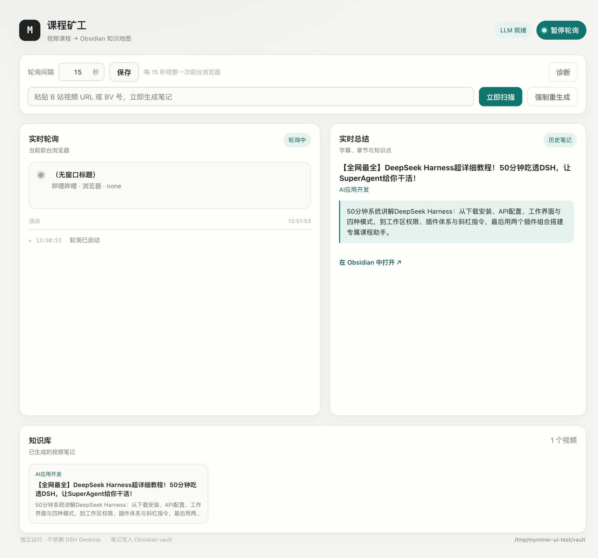
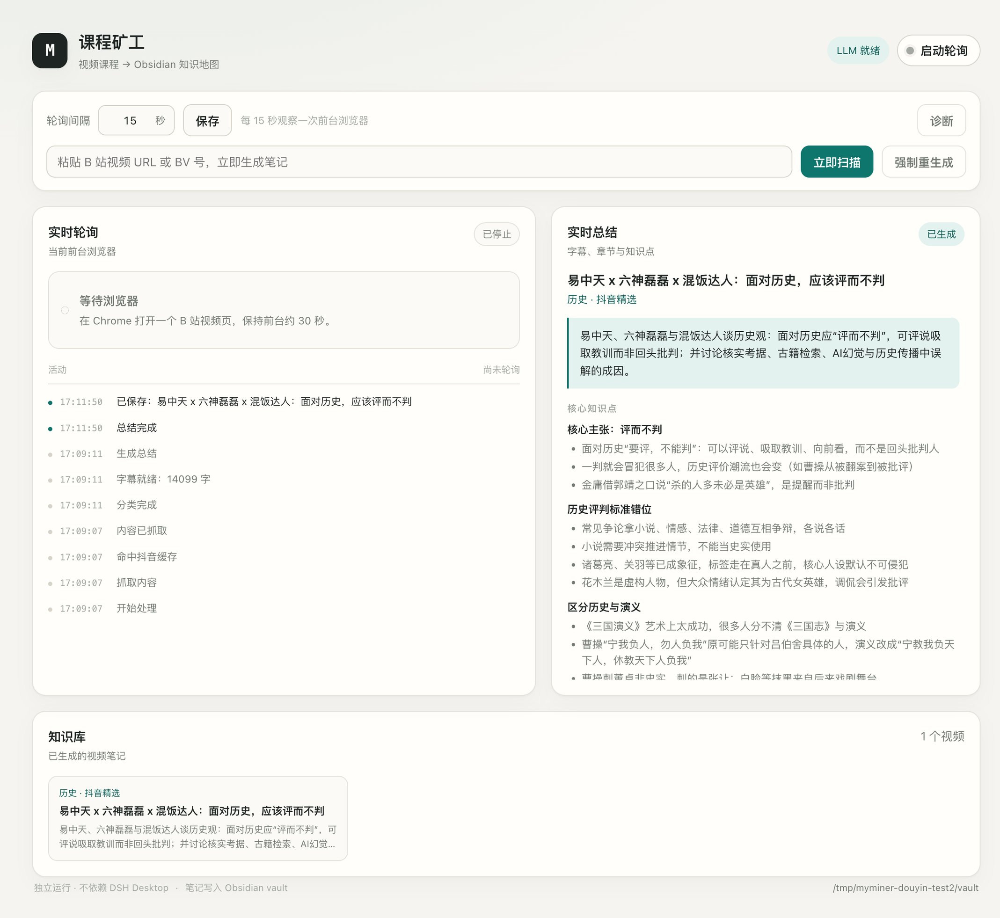
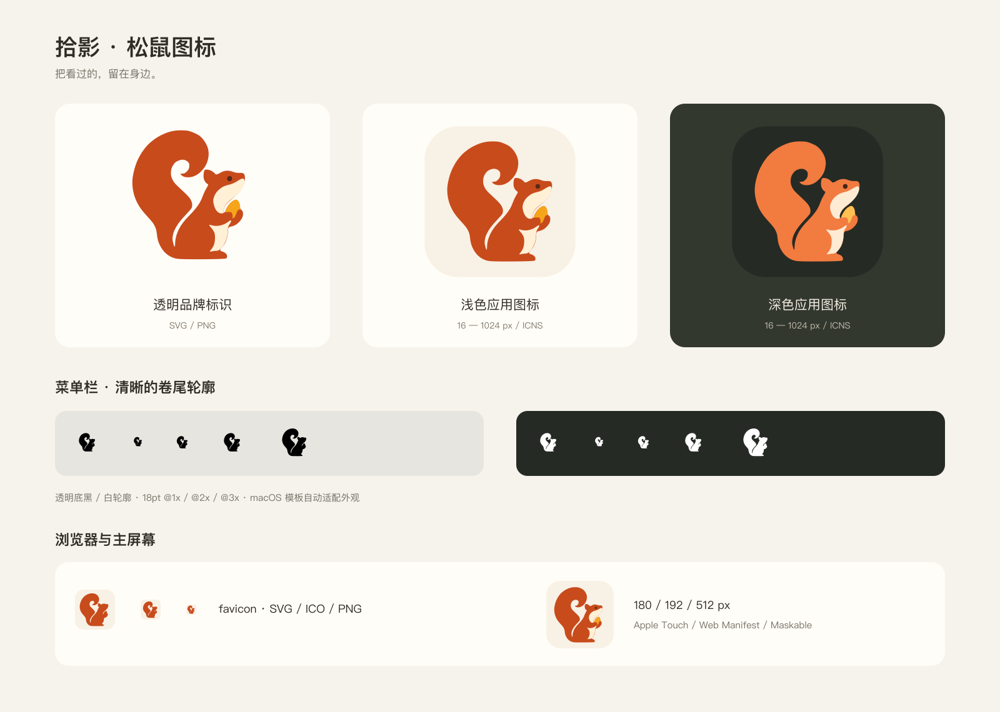

# 拾影 Seen · 视频知识笔记

把 B 站 / 抖音精选的网页课程长视频自动变成 Obsidian 知识笔记，并可选择把每篇总结写入本地 mnemon 记忆库。

> **开箱即用**：一个本地服务 + 浏览器面板 + 可选菜单栏应用，数据全部留在本机。

## 它会做什么

1. **实时检测**：每 15 秒观察当前前台浏览器；发现新的 B 站视频 / 抖音精选长视频后自动处理。
2. **学科分类**：LLM 判断视频属于哪个学科；已有学科 → 更新该学科的学习手册；新学科 → 新建学习手册。
3. **内容总结**：B 站优先抓 AI 字幕/UP 主字幕；抖音精选下载音频后用本地 Whisper 转写，再结合简介、标签、弹幕、评论生成核心知识点、讨论焦点和思维导图。没有字幕/转写时会明确标注「内容依据有限」。
4. **保存 Obsidian**：每视频一篇原子笔记 + 每学科一篇学习手册 + 全局课程总览。
5. **写入记忆（可选）**：每视频写一条精简 insight 到本地 mnemon；不需要时设 `SEEN_DISABLE_MNEMON=1` 关闭。
6. **回顾与提醒**：处理完发一条 macOS 通知；每周自动生成一篇回顾笔记；B站笔记里的时间点可以直接跳回视频。


## 独立运行（当前推荐用法）

本地服务自己完成轮询、抓取、总结和写 Obsidian，打开浏览器面板即可使用。

**前提**：

- 本机 Magpie 菜单栏应用保持运行（它提供本地模型网关）。
- Chrome 已登录 B 站（抓 AI 字幕用）。
- 抖音精选需要本机 Chrome、ffmpeg、whisper-cli 和 Whisper 模型。
- Obsidian **不需要打开**，笔记直接写入 vault。

**依赖探测**：ffmpeg、whisper-cli、无头 Chrome、yt-dlp、mnemon、obsidian-cli 都按「环境变量 → PATH → 常见安装位置」的顺序自动查找，不写死任何机器的路径。可用 `SEEN_FFMPEG_BIN` / `SEEN_WHISPER_BIN` / `SEEN_CHROME_BIN` 覆盖。

**启动**：

- 在 Finder 里双击 `seen.command`；
- 或终端执行 `node server/index.js`；
- 浏览器打开 [http://127.0.0.1:4780](http://127.0.0.1:4780)。

界面预览：

抖音精选处理结果：

页面里可以：

- 启动 / 暂停自动轮询；
- 调整轮询间隔（2–600 秒）；
- 查看当前前台浏览器和最近活动；
- 查看实时总结、章节、字幕/评论/弹幕统计；
- 粘贴 B 站 URL 手动扫描，或强制重生成；
- 点「诊断」检查权限、Obsidian、mnemon、B 站和 LLM。

**开机自动启动**：

```bash
node scripts/install-launchd.mjs
```

之后登录 macOS 会自动启动，访问 `http://127.0.0.1:4780` 即可。卸载：

```bash
node scripts/uninstall-launchd.mjs
```

服务日志在 `~/.seen/server.log` / `server.err.log`。

**抖音精选首次使用**：先安装本地 Whisper 模型（约 465MB）：

```bash
node scripts/install-whisper-model.mjs
```

之后处理一条抖音精选长视频会自动：无头 Chrome 解析页面 → ffmpeg 抽音频 → Whisper 转写 → LLM 总结。转写结果缓存在 `~/.seen/cache/douyin`，同一视频第二次不重复转写；`force` 扫描会重新转写。

**实例锁**：同一个状态目录同时只允许一个轮询实例。重复启动 Seen（比如菜单栏应用和命令行各一个）时，后启动的会进入只读并显示「另一个实例占用中」，状态锁记录在 `~/.seen/state/instance.lock`。

**每周回顾与通知**：

- 视频处理完成后会发一条 macOS 通知（标题、学科、视频名）；不需要可设 SEEN_DISABLE_NOTIFY=1 关闭。首次使用可能需要在「系统设置 → 通知」里允许。
- 每周自动生成一篇回顾笔记，位置在课程知识地图/每周回顾/2026-Wxx.md；服务启动时补生成上周的，也可以点菜单栏的「本周回顾」或调用 POST /api/review 生成本周的。文件已存在时不会覆盖。
- 回顾包含：本周新增数量、学科分布、按天记录（带笔记双链）、关键词、值得重看。

**时间戳跳转**：B站视频笔记的章节和知识点会带时间链接（例如 [02:31](…?t=151)），点一下跳回视频对应位置。抖音没有章节数据，保持纯文本。

**换模型**：默认使用本机 Magpie 的 `auto/deepseek-v4.1-flash`。如需其他 OpenAI-compatible 服务，创建 `~/.seen/llm.json`：

```json
{
  "baseURL": "http://127.0.0.1:11434/v1",
  "apiKey": "",
  "model": "qwen3:8b",
  "provider": "local"
}
```

或使用环境变量 `SEEN_LLM_BASE_URL` / `SEEN_LLM_API_KEY` / `SEEN_LLM_MODEL`。

## 菜单栏应用（macOS）

除了网页面板，还可以装一个菜单栏小应用：常驻图标、点开即用。

**构建与安装**：

```bash
cd menubar
./build.sh              # 编译到 menubar/dist/Seen.app
./build.sh --install    # 同时复制到 ~/Applications/Seen.app
open dist/Seen.app
```

**能做什么**：

- 菜单栏图标常驻，点击弹出面板；
- 看到轮询状态、轮询间隔、最近处理的视频、学科数；
- 一键开始 / 暂停轮询；
- 打开网页面板、笔记目录；
- 运行诊断（等价于 `course_map_check`）；
- 「登录时自动启动」开关：优先系统登录项（SMAppService），不适用时自动回退 LaunchAgent；
- 本地服务没在跑时自动拉起；退出应用时停掉它拉起的服务进程。

**两种开机自启的区别**：

| 方式 | 启动内容 | 适合 |
|---|---|---|
| 菜单栏应用里的「登录时自动启动」 | 菜单栏图标 + 本地服务 | 平时用菜单栏控制 |
| `node scripts/install-launchd.mjs` | 只有本地服务（无菜单栏图标） | 只想后台跑服务 |

两者不要同时开，否则会各起一个服务实例；菜单栏应用检测到服务已在跑会直接复用。

**图标**：应用、菜单栏和网页统一使用松鼠形象。菜单栏使用透明单色模板，由 macOS 自动适配浅色与深色外观；应用图标默认使用浅色版，同时提供可选深色版。



母版放在 `menubar/icon/squirrel/`，修改后从项目根目录统一导出并构建：

```bash
node scripts/export-icons.mjs
cd menubar && ./build.sh
```

运行上面的导出命令会在本地生成完整交付包 `docs/brand/squirrel-icons-v1/`（含 8 份 SVG 母版、16–1024px 应用图标、两个 ICNS、黑白菜单栏模板、透明标识以及 favicon、Apple Touch 和 Web Manifest 资源），该目录与 zip 不入库。规范见 [`docs/brand/README.md`](docs/brand/README.md)。

构建只更新工作区资源；已有工作区 `.app` 会移入 `menubar/build/previous-app.*` 保留备份。

**排障**：

- 日志：`~/.seen/menubar.log`
- 自启状态：`menubar/dist/Seen.app/Contents/MacOS/Seen --autostart status`
- 开启自启后如果没生效，到「系统设置 → 通用 → 登录项」允许 Seen；
- 移动了 app 位置后，需要关掉再打开一次自启开关。

## Obsidian 目录结构

```
<你的 vault>/
└── 课程知识地图/
    ├── 课程总览.md
    ├── 机器学习/
    │   ├── 机器学习 学习手册.md
    │   ├── 梯度下降详解.md
    │   └── ...
    └── 前端开发/
        ├── 前端开发 学习手册.md
        └── ...
```

- **视频笔记**：每视频一篇，含 frontmatter、核心知识点、弹幕/评论焦点、Mermaid 思维导图、来源统计。
- **学习手册**：学科级知识地图（Mermaid mindmap + 视频链接列表），底部「我的补充」区不会被覆盖。
- **课程总览**：全部学科与视频数量。

## 内容来源与可信度

- **有 AI 字幕/UP 主字幕**：笔记 frontmatter 标记 `contentSource: ai-subtitle` 或 `up-subtitle`，`contentQuality: full`；知识点以字幕为主。
- **抖音精选**：`contentSource: whisper`、`contentQuality: full`；音频用本地 Whisper 转写，笔记会标注转写来源。当前只取抖音的评论/弹幕总数，不抓取正文，笔记和页面都会标注「暂未抓取」。
- **没有字幕/转写**：标记 `contentSource: metadata`、`contentQuality: metadata-only`，笔记顶部会出现「内容依据有限」警告；核心知识点只基于简介/标签，弹幕和评论只用于讨论焦点。
- 统计区会显示「抓取 X 条 / 全站 Y 条」，不再把匿名接口拿到的 3 条热评写成视频实际评论数。
- AI 字幕可能包含同音错字，插件会让模型结合上下文纠正，但不保证 100% 准确。

> 隐私说明：`useBrowserCookies: true` 时，插件只在抓取 B 站字幕/评论时通过 `yt-dlp` 临时读取 Chrome 的 B 站 Cookie，Cookie 文件写入系统临时目录并在调用后立即删除，不写入日志、不写入 Obsidian、不写入配置。抖音解析使用独立临时 profile 的无头 Chrome，不读取用户 Chrome Cookie；profile 和音频临时文件用后删除。

## 配置

默认自动检测 Obsidian vault（`~/Library/Application Support/obsidian/obsidian.json`）。独立服务的配置通过环境变量调整：

```yaml
- id: seen-core
  name: seen-core
  config:
    pollIntervalMs: 15000
    stablePolls: 2
    noteRoot: 课程知识地图
    vaultPath: ~/Documents/Obsidian Vault   # 改成你的 vault 路径
    fetchTranscript: true
    useBrowserCookies: true
    cookieBrowser: chrome
    commentLimit: 50
    enableMnemon: true
    mnemonStore: default
    openInObsidian: false
```

| 配置 | 默认 | 说明 |
|---|---|---|
| `enabled` | true | 总开关 |
| `pollIntervalMs` | 15000 | 轮询间隔（毫秒） |
| `stablePolls` | 2 | 连续 N 次同一新标题才处理 |
| `vaultPath` | 自动 | Obsidian vault 绝对路径 |
| `noteRoot` | 课程知识地图 | vault 下的笔记根目录 |
| `stateDir` | ~/.seen/state | 状态与日志目录 |
| `provider` / `model` | null | 跟随默认模型 |
| `maxTokens` | 4096 | 总结最大 token |
| `fetchContent` | true | 是否抓取 B 站内容 |
| `fetchTranscript` | true | 是否抓取 AI/UP 主字幕作为完整讲解文本 |
| `useBrowserCookies` | true | 是否允许 yt-dlp 临时读取浏览器 B 站 Cookie（用于 AI 字幕和评论分页） |
| `cookieBrowser` | chrome | 从哪个浏览器读取 Cookie（chrome/safari/edge） |
| `transcriptLangs` | ai-zh, zh-Hans… | 字幕语言优先级 |
| `useTranscriptCache` | true | 复用已下载的 AI 字幕（避免重复 LLM 分块） |
| `transcriptCacheDays` | 7 | 字幕缓存保留天数 |
| `douyinCacheDays` | 7 | 抖音页面/转写缓存天数 |
| `chromePath` | null | 可选：自定义 Chrome 可执行文件路径 |
| `ffmpegBin` | null | 可选：自定义 ffmpeg 路径 |
| `whisperBin` | null | 可选：自定义 whisper-cli 路径 |
| `whisperModel` | null | 可选：自定义 Whisper 模型路径 |
| `commentLimit` | 50 | 最多抓取多少条高赞评论（最大 100） |
| `ytDlpBin` | 自动 | yt-dlp 路径（默认自动探测） |
| `enableMnemon` | true | 是否写 mnemon |
| `mnemonBin` | 自动 | mnemon CLI 路径 |
| `mnemonStore` | default | Memory Space id |
| `openInObsidian` | false | 生成后是否用 obsidian-cli 打开笔记 |

## 文件与日志

| 内容 | 位置 |
|---|---|
| 状态文件 | `~/.seen/state/state.json` |
| 运行日志 | `~/.seen/state/poll.log` |
| 独立服务开关/间隔 | `~/.seen/ui.json` |
| 独立服务日志 | `~/.seen/server.log` / `server.err.log` |
| 独立服务地址 | `http://127.0.0.1:4780` |

## 排障

### 打开视频一直没有笔记

按顺序检查：

1. 运行 `course_map_check`：
   - `foreground` ❌ → 没有 macOS 权限，按上文授权后重启服务。
   - `vault` ❌ → Obsidian vault 路径不对，检查配置。
   - `mnemon` ❌ → 只是记忆写入失败，笔记仍应生成。
   - `bilibili` ❌ → 网络/B站风控，稍后重试。
2. 看 `poll.log` 最后几行。
3. 确认浏览器地址栏是 `https://www.bilibili.com/video/BV...`，不是首页/搜索页/直播/番剧。

### 笔记生成了但学科不对

学科由 LLM 判断。可以手动修改视频笔记 frontmatter 的 `subject`，并把笔记移动到对应学科目录；插件不会自动纠正已生成的笔记。

### 重复视频

插件按 bvid（优先）或归一化标题去重。若同一视频换标题，可能生成新笔记；可手动删除多余笔记（Obsidian 中操作）。

### Word 输出没了

本版本专注 Obsidian Markdown，不再生成 Word。原版 Word 功能已停用。


## 技术说明

- 本项目最初基于 `linner1224/dsh-video-coursemap` 2.0.0（MIT）的架构，保留原 B 站抓取思路，后续已独立演进。
- macOS 前台检测使用 `lsappinfo` + AppleScript；Windows 保留原 PowerShell 实现。
- 所有数据本地处理：Obsidian 笔记在本地 vault，mnemon 数据在 `~/.mnemon`。
- 不读取浏览器 Cookie、不登录 B 站、不下载视频。
