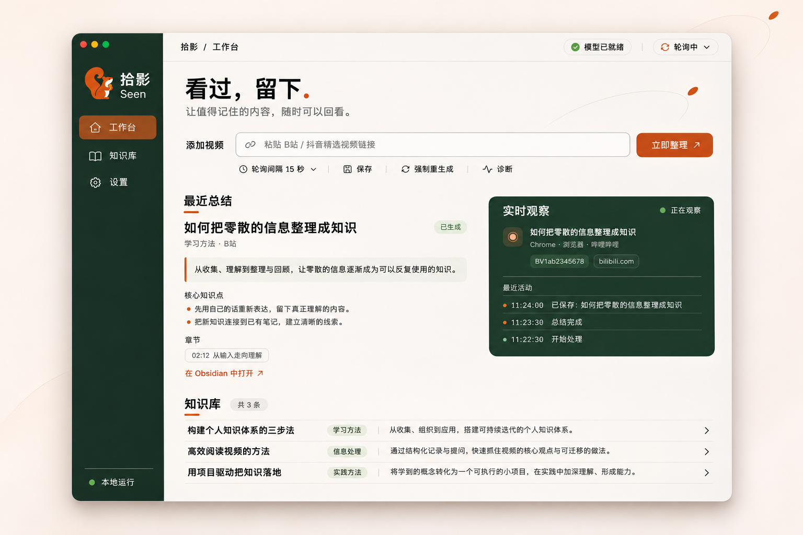

# 拾影 Seen

> 把看过的长视频，变成可回顾的知识笔记。

**Seen** 在本机跑一个轻量服务，自动发现你在浏览器里看的 B 站、抖音精选、YouTube 长视频，抓字幕或转写音频，让大模型整理成结构化笔记，直接写进你的 Obsidian 知识库。

笔记在你的电脑上，模型可以是你自己的，不需要登录任何账号，也不上传视频内容。

<p align="center">
  
</p>

<sub>概念示意图，内容为虚构示例；实际界面以当前版本为准。</sub>

---

## 为什么需要它

看长视频学到的东西，往往在关掉页面之后就散了。截屏、收藏、收藏夹都不解决问题——你需要的是一份**能重新读、能按学科组织、能跳回原视频**的笔记。

拾影把"看完就忘"变成"看完就存"：

- 你照常看视频，它在后台识别、抓取、总结、归档；
- 每篇笔记都能追溯到原视频的某个时间点；
- 学科会自动归类，形成一套持续生长的知识地图。

## 功能

| 能力 | 说明 |
|---|---|
| **自动检测** | 每 15 秒观察前台浏览器，识别 B 站、抖音精选、YouTube 中正在播放的视频 |
| **内容抓取** | B 站取 AI 字幕或 UP 主字幕；YouTube 优先取人工字幕，没有则下载音频本地转写；抖音下载音频后用本地 Whisper 转写 |
| **智能总结** | 生成一句话摘要、核心知识点、讨论焦点、Mermaid 思维导图 |
| **学科归类** | 自动判断学科，维护学科学习手册与全局课程总览 |
| **时间戳跳转** | B 站与 YouTube 笔记的章节和知识点带时间链接，点击跳回视频对应位置 |
| **知识索引** | 每次生成笔记后更新索引表，按时间、学科检索全部内容 |
| **每周回顾** | 自动汇总本周新增内容，生成一篇回顾 |
| **阶段通知** | 开始整理、进入本地转写（附预计耗时）、笔记生成、处理失败，四个节点各发一条 macOS 通知 |
| **模型自由** | 24 个内置供应商预设，支持任意 OpenAI 兼容接口；检测到本机 Magpie 时自动使用 |

## 快速开始

### 环境要求

- macOS 12 或更新版本（菜单栏应用需要简体中文系统或英文系统均可）
- [Node.js](https://nodejs.org/) 20 或更新版本
- [Obsidian](https://obsidian.md/) 和一个 vault
- 一个可用的模型 API Key（或本机运行 Ollama、LM Studio、Magpie 等）
外部工具按需使用，**已安装的本机版本始终优先**，没有的话大部分会自动补上：

| 工具 | 用在哪 | 没装时 |
|---|---|---|
| [yt-dlp](https://github.com/yt-dlp/yt-dlp) | YouTube 解析、B 站 AI 字幕 | 首次需要时自动下载到 `~/.seen/bin`；GitHub 慢或失败会自动换镜像重试 |
| [ffmpeg](https://ffmpeg.org/) | 音频预处理（抖音、YouTube 无字幕） | 首次需要时自动下载静态二进制到 `~/.seen/bin`；同样有镜像兜底 |
| Whisper 模型 | 无字幕时本地转写 | 面板「诊断」里按推荐选一个下载（推荐 Large v3 Turbo，1.6GB）；HuggingFace 慢时自动回落 hf-mirror |
| whisper-cli | 无字幕时本地转写 | 诊断面板里点「安装 whisper-cli」（自动跑 brew）；也可自己 `brew install whisper.cpp` |
| Chrome | 抖音页面解析 | 需自行安装 |

项目本身零 npm 依赖：不需要 `npm install`，克隆下来就能跑。

**下载镜像**：GitHub 直连（yt-dlp、ffmpeg）失败时会自动换公共镜像重试；模型按 `HF_ENDPOINT` → huggingface.co → hf-mirror.com 依次尝试。想指定自己的 GitHub 加速地址：

```bash
export SEEN_GH_MIRROR=https://ghproxy.net/     # 支持逗号分隔多个
export HF_ENDPOINT=https://hf-mirror.com       # HuggingFace 镜像
```

yt-dlp 下载完会用官方 `SHA2-256SUMS` 校验 SHA256：走镜像下载时如果拿不到校验文件或对不上，会直接中止，不会安装来路不明的二进制。ffmpeg-static 官方不提供校验文件，只能靠官方优先来降低风险。

### 1. 获取代码

```bash
git clone https://github.com/zayn-0101/seen.git
cd seen
```

### 2. 配置模型（首次必做）

启动服务后，打开面板的「设置」：

```bash
node server/index.js
```

浏览器会自动打开 <http://127.0.0.1:4780>。点右上角模型状态、左侧「设置」或直接访问 <http://127.0.0.1:4780/#settings>：

1. 选择供应商（按 国内 / 国际 / 本地 分组）
2. 粘贴 API Key
3. 点「获取模型列表」挑一个模型
4. 点「测试连接」确认可用
5. 保存

保存后立即生效，无需重启。

> 如果本机装了 Magpie 网关，Seen 启动时会自动识别并使用，可以跳过这一步。

### 3. 启动

三种方式，任选其一：

```bash
node server/index.js          # 前台运行，日志直接输出
npm start                     # 同上
open seen.command             # 在访达里双击，效果相同
```

服务默认监听 `127.0.0.1:4780`，浏览器面板会自动打开。

### 4. 验证

在面板点「诊断」。全部正常时会显示「一切正常」；有问题的项会列出具体原因。

然后打开一个 B 站、抖音精选或 YouTube 视频，等待 30 秒左右，看是否生成笔记。

### 5. 菜单栏应用（可选）

想要常驻菜单栏、点开即用，可以安装 Swift 应用：

```bash
cd menubar
./build.sh --install     # 编译并安装到 ~/Applications/Seen.app
open ~/Applications/Seen.app
```

菜单栏应用会：

- 显示轮询状态、最近处理的视频、学科数
- 一键启停轮询
- 打开网页面板、笔记目录
- 生成每周回顾
- 运行诊断
- 管理登录时自动启动

本地服务没在跑时会自动拉起，退出时停掉它启动的服务。

---

## 使用

### 自动检测

服务启动后默认开始轮询，每 15 秒通过 AppleScript 和 `lsappinfo` 读取前台窗口。识别到 B 站、抖音精选或 YouTube 的视频页面后：

1. 连续两次检测到同一视频才处理（避免误触）
2. 抓取简介、标签、字幕或音频
3. 调用模型总结
4. 写入 Obsidian
5. 发送通知

轮询间隔、稳定次数都可以在面板或配置文件里调整。

### 手动扫描

不想等自动检测时，直接粘贴链接：

- 面板顶部输入框粘贴 B 站 / 抖音 / YouTube 链接 → 点「立即整理」
- 「强制重生成」会忽略已有笔记，重新总结

### 面板

<http://127.0.0.1:4780> 是主界面：

- **工作台**：视频链接输入、轮询控制、最近总结、实时观察
- **知识库**：已生成的视频笔记卡片
- **设置**：模型配置、轮询间隔、记忆库开关

### 菜单栏

点击菜单栏的松鼠图标弹出面板，包含轮询状态与快捷操作。

如果图标没出现，检查是否有 Bartender、Ice 这类菜单栏管理工具把新图标收进了折叠区。

---

## 输出

### Obsidian 目录结构

```
<你的 vault>/
└── 课程知识地图/
    ├── 课程总览.md              # 全部学科与视频数量
    ├── 索引.md                  # 全部视频索引表，自动维护
    ├── 每周回顾/
    │   └── 2026-W46.md         # 每周一篇，已存在不覆盖
    ├── 机器学习/
    │   ├── 机器学习 学习手册.md
    │   ├── 梯度下降详解.md
    │   └── ...
    └── 前端开发/
        └── ...
```

### 视频笔记

每视频一篇原子笔记，包含：

- frontmatter：标题、学科、来源、链接、时间、内容来源标签
- 一句话摘要
- 核心知识点（带时间戳链接，可跳回视频）
- 弹幕 / 评论焦点
- Mermaid 思维导图
- 抓取统计与可信度标注

### 学习手册与总览

学习手册是学科级的知识地图，包含 Mermaid mindmap 和该学科全部视频的链接。

它们只更新 `<!-- AUTO:START -->` 与 `<!-- AUTO:END -->` 之间的内容，你在「我的补充」里写的东西不会被覆盖。

### 索引

每次生成笔记后自动重建 `索引.md`：

| 日期 | 标题 | 学科 | 来源 |
|---|---|---|---|
| 2026-11-13 | 梯度下降为什么有效 | 机器学习 | B站 |
| 2026-11-14 | 线性代数的本质 | 数学 | YouTube |
| 2026-11-14 | 三分钟看懂相对论 | 物理 | 抖音 |

### 每周回顾

包含本周新增数量、学科分布、按天记录（带笔记双链）、关键词、值得重看。

触发方式：

- 服务启动时自动补生成上周
- 菜单栏点「本周回顾」
- `POST http://127.0.0.1:4780/api/review`

已存在的文件不会被覆盖。

### 通知

四个节点各发一条 macOS 通知，避免几十秒到十几分钟的等待完全没有反馈：

| 节点 | 内容 |
|---|---|
| 识别到视频 | 「拾影 · 开始整理」，副标题是平台名 |
| 进入本地转写 | 「拾影 · 本地转写中」，正文是预计耗时（如「预计约 15 分钟」） |
| 处理完成 | 「拾影 · 笔记已生成」，副标题是学科和平台 |
| 处理失败 | 「拾影 · 处理失败」，正文是具体原因 |

中间的下载、分类、总结只在面板更新进度，不弹通知。同一内容 5 秒内只发一次。

如果收不到，检查「系统设置 → 通知」里是否允许了 Seen。

---

## 配置

### 模型

配置保存在 `~/.seen/llm.json`（权限 600），也可以直接用环境变量覆盖。

**内置供应商**（选完只需填 API Key）：

- **国内**：DeepSeek、通义千问、Kimi、智谱 GLM、豆包、文心、混元、星火、MiniMax、阶跃星辰、硅基流动
- **国际**：OpenAI、Gemini、OpenRouter、Grok、Groq、Mistral、Together、Fireworks
- **本地**：Magpie（自动检测）、Ollama、LM Studio、vLLM
- **自定义**：手动填 baseURL 和模型 ID

**优先级**：保存的设置 → 环境变量 → 自动探测 Magpie → 未配置（会提示你先设置）。

### 服务

常用环境变量：

| 变量 | 默认 | 说明 |
|---|---|---|
| `SEEN_PORT` | 4780 | 服务端口 |
| `SEEN_HOST` | 127.0.0.1 | 监听地址 |
| `SEEN_NO_OPEN` | — | 设为 1 时不自动打开浏览器 |
| `SEEN_VAULT` | 自动检测 | Obsidian vault 路径 |
| `SEEN_NOTE_ROOT` | 课程知识地图 | vault 下的笔记根目录 |
| `SEEN_STATE_DIR` | ~/.seen/state | 状态与锁文件目录 |
| `SEEN_LLM_BASE_URL` | — | 模型服务地址 |
| `SEEN_LLM_API_KEY` | — | 模型 API Key |
| `SEEN_LLM_MODEL` | — | 模型名 |
| `SEEN_DISABLE_NOTIFY` | — | 设为 1 关闭通知 |
| `SEEN_DISABLE_MNEMON` | — | 设为 1 关闭记忆写入 |
| `SEEN_CHROME_BIN` | 自动探测 | Chrome 可执行文件 |
| `SEEN_FFMPEG_BIN` | 自动探测 | ffmpeg 可执行文件 |

### 文件位置

| 内容 | 路径 |
|---|---|
| 状态与锁 | `~/.seen/state/` |
| 模型配置 | `~/.seen/llm.json` |
| 面板开关与间隔 | `~/.seen/ui.json` |
| 字幕 / 抖音 / YouTube 缓存 | `~/.seen/cache/` |
| Whisper 模型 | `~/.seen/models/ggml-small.bin` |
| 服务日志 | `~/.seen/server.log`、`server.err.log` |
| 菜单栏日志 | `~/.seen/menubar.log` |

---

## 可选集成

### mnemon

本机装了 [mnemon](https://github.com/) 记忆库时，可以把每条总结写进去。设置页会自动检测 CLI：

- 检测到 → 开关自动打开，可手动关闭
- 没检测到 → 开关置灰

### Obsidian CLI

装了 `obsidian-cli` 并开启 `openInObsidian` 后，生成笔记会自动在 Obsidian 中打开。

---

## 常见问题

### 看了视频但没有生成笔记

按顺序检查：

1. 面板点「诊断」，看哪一项失败
2. 确认浏览器地址栏是具体的视频页，不是首页、搜索页、直播或番剧
3. 看 `~/.seen/state/poll.log` 最后几行
4. 确认模型服务可用（诊断里的「模型服务」）

### 诊断提示需要「自动化」权限（macOS）

macOS 读取浏览器窗口需要 AppleScript 自动化权限：

1. 打开「系统设置 → 隐私与安全性 → 自动化」
2. 找到 Seen（或你启动服务的终端），勾选 System Events 和浏览器

注意：**macOS 27 已移除独立的「辅助功能」分类**，网上旧教程的路径在新系统里找不到，属于系统改版，不是应用问题。

### 菜单栏图标看不见

如果装了 Bartender、Ice、Hidden Bar 等菜单栏管理工具，新图标默认可能被收进折叠区。点开折叠箭头找一下，或在工具的设置里把 Seen 设为始终显示。

### 抖音视频没有笔记

抖音精选依赖 Chrome（页面解析）和 whisper-cli（音频转写）。ffmpeg 缺失时会自动下载，需要手动准备的是 Chrome、whisper-cli 和转写模型：

- **whisper-cli**：诊断面板里点「安装 whisper-cli」，应用会代跑 `brew install whisper.cpp`，进度显示在面板上（也可以自己 `brew install whisper.cpp`）。
- **Chrome**：需要自己装，`brew install --cask google-chrome`。

诊断里的项如果标红，就是缺组件。

### YouTube 视频没有笔记

YouTube 支持依赖 `yt-dlp` 和一条能访问 YouTube 的网络。查找顺序是：设置里的 `ytdlpBin` → PATH（`brew install yt-dlp` 装的那份）→ `~/.seen/bin/yt-dlp`（应用自动下载的）。

**没装也能用**：第一次处理 YouTube 视频时，应用会自动下载官方最新版到 `~/.seen/bin`（约 37MB）。想提前装好：

```bash
node scripts/install-yt-dlp.mjs          # 自动装到 ~/.seen/bin
node scripts/install-yt-dlp.mjs --force  # 已存在也重新下载
brew install yt-dlp                      # 或者用系统包管理器
```

- 诊断里「yt-dlp」「YouTube 网络」两项都要是绿的；
- 在中国大陆需要先开代理，系统级代理即可，应用会沿用；
- 有人工字幕的视频通常几秒完成；没有字幕的视频会下载音频用本地 Whisper 转写，一般 1–3 分钟；
- 无字幕视频还需要 ffmpeg、whisper-cli 和转写模型：ffmpeg 缺失会自动下载，whisper-cli 用诊断面板的「安装」按钮，模型在面板里按推荐选一个（推荐 Large v3 Turbo 1.6GB）；
- 会员视频、私享视频、年龄限制视频会被 YouTube 拒绝，属于预期情况；
- 如果自动下载的版本报证书错误（公司网络装了 HTTPS 代理时会这样），改用 `brew install yt-dlp` 装的那份即可。

### 学科判断不对

学科由模型判断。可以手动修改笔记 frontmatter 的 `subject` 并移动文件，应用不会自动纠正已生成的笔记。

### 同一个视频生成了两篇

按 bvid 或归一化标题去重。如果视频换了标题，可能被当成新内容，手动删掉多余的那篇即可。

### 端口被占用

```bash
SEEN_PORT=4781 node server/index.js
```

### 如何卸载

```bash
# 停掉菜单栏应用
rm -rf ~/Applications/Seen.app

# 如果设了开机自启
node scripts/uninstall-launchd.mjs

# 删除运行数据（笔记不受影响）
rm -rf ~/.seen
```

---

## 架构

```
web/         浏览器面板（原生 HTML/CSS/JS）
  ↕ HTTP + SSE
server/      本地服务（API、SSE、静态文件、LLM 适配）
  ↕
core/        视频引擎（检测、抓取、总结、渲染、写入）
  ↓
Obsidian     vault 中的 Markdown
```

- **core**：纯 ESM JavaScript，零运行时依赖，可单独 import 和测试
- **server**：Node 内置 http，不依赖框架
- **web**：无构建步骤的原生前端
- **menubar**：Swift 6 + AppKit，只通过 HTTP 调服务

详细设计见 [docs/architecture.md](docs/architecture.md)，模块契约见 [docs/contracts.md](docs/contracts.md)。

## 开发

```bash
cd core && node --test          # 运行测试（93 项）
cd menubar && ./build.sh        # 编译菜单栏应用
npm run check                   # 语法检查
```

开发约定见 [CLAUDE.md](CLAUDE.md)。

## 数据与隐私

- 所有笔记、缓存、配置都在本机
- 视频内容只在总结时发送给你配置的模型服务
- 读取 B 站 Cookie 仅用于抓取字幕和评论，通过 yt-dlp 临时读取，用后立即删除，不写日志、不写配置
- 抖音解析使用独立的临时 Chrome profile，不读取你日常浏览器的 Cookie
- YouTube 解析通过本机 yt-dlp 完成，不读取浏览器 Cookie，也不调用 YouTube Data API
- API Key 保存在 `~/.seen/llm.json`（权限 600），接口回显脱敏，日志不记录

## 已知限制

- 只支持 B 站、抖音精选和 YouTube，其它平台暂未接入
- 抖音不抓取评论/弹幕正文，只取总数
- YouTube 不抓取评论；没有字幕的视频要下载音频本地转写，耗时明显更长
- YouTube 的自动字幕接口限制较严，实际经常走本地转写兜底
- AI 字幕与本地转写都可能存在同音错字，笔记不保证 100% 准确
- 只在 macOS 上测试过；Windows 保留了前台检测的实现但没有维护
- 抖音解析依赖页面结构、YouTube 解析依赖 yt-dlp 的接口约定，平台或工具改版后可能失效

## 许可

MIT License。本项目最初基于 [linner1224/dsh-video-coursemap](https://github.com/linner1224/dsh-video-coursemap) 2.0.0（MIT）的架构，保留其 B 站抓取思路，已独立演进为 macOS / Obsidian 方向。
