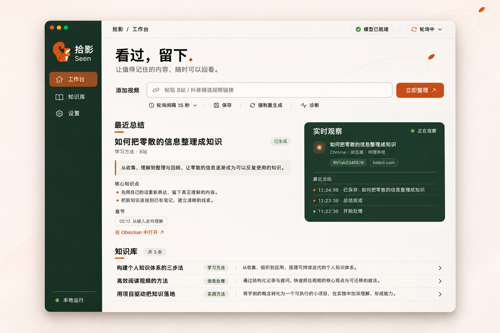

# 拾影 Seen

> 把看过的长视频，变成可回顾的知识笔记。

Seen 在本机跑一个轻量服务，自动发现你在浏览器里看的 **B 站 / 抖音精选 / YouTube** 长视频，抓字幕或转写音频，交给大模型整理成结构化笔记，直接写进你的 Obsidian 知识库。

笔记、缓存和配置都留在你自己的电脑上，模型可以用你自己的，不需要登录任何账号。视频内容只会发送给你配置的模型服务做总结，不经过拾影的中转服务器。

<p align="center">
  
</p>

<sub>概念示意图，内容为虚构示例；实际界面以当前版本为准。</sub>

---

## 目录

- [特性](#特性)
- [环境要求](#环境要求)
- [快速开始](#快速开始)
- [使用](#使用)
- [输出](#输出)
- [配置](#配置)
- [平台支持](#平台支持)
- [常见问题](#常见问题)
- [架构](#架构)
- [开发](#开发)
- [数据与隐私](#数据与隐私)
- [已知限制](#已知限制)
- [反馈与问题](#反馈与问题)
- [许可](#许可)

## 特性

| 能力 | 说明 |
|---|---|
| **自动检测** | 每 15 秒观察前台浏览器，识别 B 站、抖音精选、YouTube 正在播放的视频 |
| **内容抓取** | B 站优先通过播放器接口取 UP 主/AI 字幕（AI 字幕走 wbi/v2 并校验 aid+cid），取不到再走 yt-dlp；仍没有则下载音频本地转写。YouTube 取人工/自动字幕（优先原声语言），没有则本地转写；抖音下载音频本地转写 |
| **智能总结** | 摘要三段（概述/核心问题/核心结论）、核心知识点、可质疑之处或常见误解、复习卡片，按视频类型套用不同结构，全中文输出 |
| **学科组织** | 自动判断学科，维护学科学习手册与全局总览 |
| **时间戳跳转** | B 站和 YouTube 的章节、知识点带时间链接，点击跳回视频对应位置（抖音没有时间链接） |
| **知识索引** | 整理结束后重建索引表，按时间、学科检索全部内容 |
| **每周回顾** | 自动汇总本周新增，生成一篇回顾 |
| **间隔复习** | 每篇笔记自动生成复习卡片，按 1/3/7/16/35 天安排复习，面板「今日复习」三键打分 |
| **阶段通知** | 开始整理 / 本地转写（附预计耗时）/ 笔记生成 / 处理失败，四个节点各一条 macOS 通知 |
| **模型自由** | 23 个内置供应商预设 + 自定义，支持任意 OpenAI 兼容接口 |
| **失败重试** | 处理失败会保留视频链接与原因，面板里可一键重试 |
| **批量整理** | 一次粘贴多个链接（最多 20 个），串行处理并汇总结果 |
| **知识库搜索** | 按标题、摘要、关键词、学科筛选已生成的笔记；同时搜索视频笔记目录中的 Markdown 正文 |
| **概念浏览** | 汇总所有笔记的核心概念，点概念看关联视频；学科手册自动列出跨多篇笔记的核心概念 |
| **学科分组** | 知识库默认按学科分组，一眼看出知识分布在哪些领域 |
| **问笔记库** | 用自然语言提问，按全文检索找到相关笔记后让模型回答，并给出可跳转的引用 |
| **标签合并** | 面板列出全库主题标签，可把同义或包含关系的标签合并成一个，自动改写所有相关笔记 |
| **更新提示** | 启动时检查新版本，落后时在面板顶部提示；侧栏「更新」可随时手动检查 |

## 环境要求

- macOS 13 或更新（Apple Silicon 或 Intel，简体中文或英文系统均可）
- [Node.js](https://nodejs.org/) 20 或更新
- [Obsidian](https://obsidian.md/) 和一个 vault
- 一个可用的模型 API Key（或本机运行 Ollama、LM Studio、Magpie 等）
- 可选：[Homebrew](https://brew.sh/)，仅用于安装 whisper-cli

项目本身零 npm 依赖，不需要 `npm install`。下面这些外部工具**按需使用**，已安装的优先用本机的，缺了大部分会自动补上：

| 工具 | 用在哪 | 缺失时 |
|---|---|---|
| [yt-dlp](https://github.com/yt-dlp/yt-dlp) | YouTube 解析、B 站字幕与音频下载 | 自动下载到 `~/.seen/bin` |
| [ffmpeg](https://ffmpeg.org/) | 音频预处理 | 自动下载静态二进制 |
| Whisper 模型 | 无字幕时的本地转写 | 面板里按推荐选一个下载 |
| whisper-cli | 无字幕时的本地转写 | 面板里点按钮代跑 Homebrew（需先装 Homebrew） |
| Chrome | 抖音页面解析 | 需自行安装 |

## 快速开始

### 方式一：下载安装包（推荐）

从 [Releases](https://github.com/zayn-0101/seen/releases) 下载最新的 `Seen-v<版本>.dmg`，打开后把 `Seen.app` 拖进「应用程序」。

应用没有 Apple 开发者签名（安装包用本地固定证书签名），首次打开可能被 Gatekeeper 拦截：在「应用程序」里**右键点 Seen → 打开**，弹窗里再点一次「打开」。或者执行：

```bash
xattr -dr com.apple.quarantine /Applications/Seen.app
```

之后菜单栏会出现松鼠图标，点开 → 「打开面板」，接着做下面的**配置模型**。

安装包内置了 Node 运行时和服务代码，不需要另外装 Node。同一份安装包同时支持 Apple Silicon 和 Intel Mac。

### 方式二：从源码运行（开发者）

适合想改代码、或想直接运行仓库最新源码的情况。

**1. 获取代码**

```bash
git clone https://github.com/zayn-0101/seen.git
cd seen
```

**2. 启动**

```bash
node server/index.js     # 前台运行，日志直接输出
npm start                # 同上
open seen.command        # 在访达里双击
```

服务监听 `127.0.0.1:4780`，浏览器面板会自动打开。

**3. 编译菜单栏应用（可选）**

```bash
cd menubar
./build.sh --install    # 编译并安装到 ~/Applications/Seen.app
./build.sh --bundle     # 或者构建含 Node 运行时的可分发包
```

打包机首次构建前，在「钥匙串访问 → 证书助理」创建一张名为 `Seen Local Signing` 的「代码签名」自签名证书；`build.sh` 会自动用它签名。没有证书时回退 ad-hoc，重装会重置 macOS 的文件访问授权。

每次构建会把旧的 `menubar/dist/Seen.app` 移到 `menubar/build/previous-app.*` 留作备份，不会自动删除；构建多了会占空间。默认只预览，确认后再加 `--apply`：

```bash
du -sh menubar/build
npm run prune:build -- --keep 3          # 预览：保留最新 3 份
npm run prune:build -- --apply --keep 3  # 真正删除
```

`--install` 会先在同目录暂存新版本，成功后再替换 `~/Applications/Seen.app`；普通命令失败或收到 INT/TERM/HUP 时会恢复旧版本。SIGKILL、断电等无法捕获的情况不能保证自动回滚，旧版本会留在 `~/.seen/install-backups/`（可用 `SEEN_INSTALL_BACKUP_DIR` 覆盖，备份目录必须与安装目录在同一磁盘），需要时手动放回。

安装备份同样不会自动删除。默认保留最新 2 份，先预览，确认后再加 `--apply`：

```bash
npm run prune:install -- --keep 2          # 预览：保留最新 2 份
npm run prune:install -- --apply --keep 2  # 真正删除
```

### 如何更新

安装包里内嵌了服务代码，所以**升级要重新下载 dmg 覆盖安装**（直接把新的 `Seen.app` 拖进「应用程序」替换旧的；源码运行的话 `git pull` 后重启服务即可）。

从 0.5.2 起安装包使用固定的本地签名证书构建，升级重装一般不再重置 macOS 的文件访问授权；第一次安装或更换证书时仍需授权一次。

应用每次启动会查一次 GitHub 最新版本，落后时面板顶部出现提示条；侧栏「更新」按钮可以随时手动检查，已是最新版本时也会给出提示。

### 配置模型（首次必做）

在面板右上角点模型状态，或直接访问 <http://127.0.0.1:4780/#settings>：

1. 选择供应商（按 国内 / 国际 / 本地 分组）
2. 粘贴 API Key
3. 点「获取模型列表」挑一个
4. 点「测试连接」确认可用
5. 保存

保存后立即生效。如果本机装了 Magpie 网关，启动时会自动识别并使用，可以跳过这一步。

### 验证

面板点「诊断」，全部正常会显示「一切正常」。然后打开一个视频页面，前台保持 30 秒左右，看是否生成笔记。

---

## 使用

### 自动检测

服务每 15 秒读取前台窗口（AppleScript + `lsappinfo`）。识别到视频页面后：

1. 连续两次检测到同一视频才处理，避免误触
2. 抓取简介、标签、字幕或音频
3. 调用模型总结
4. 写入 Obsidian
5. 发通知

轮询间隔可以在工作台工具栏调整；稳定次数固定为连续两次。

处理是串行的：第一条视频还在转写时又打开第二条，轮询不会停，第二条会先进入队列，等第一条写完后自动接着处理。自动识别、手动整理、失败重试、重刷历史和字幕重整共用同一个队列，最多等待 8 条；自动识别按视频去重。停止轮询只会清掉等待中的自动任务，已经提交的手动操作会继续执行。

### 手动整理

面板顶部输入框粘贴链接 → 点「立即整理」。「强制重生成」会忽略已有笔记重新总结；「重刷历史」会按新格式重做已收录的视频，优先复用已有缓存，缓存失效时可能重新抓取或转写。

### 面板

<http://127.0.0.1:4780> 是主界面：

- **工作台**：视频链接输入、轮询控制、最近总结、实时观察
- **知识库**：已生成的视频笔记卡片，可切换「概念」「标签」浏览，也能直接在「问笔记库」里提问
- **今日复习**：到期笔记按间隔重复排队，点「忘了 / 模糊 / 记住了」更新下次复习时间
- **设置**：模型配置、记忆库开关、发布前润色开关

### 通知

四个节点各一条 macOS 通知。通知的**标题永远是视频标题**，平台、阶段放在副标题里，不再单占一行：

| 节点 | 标题 | 副标题 | 正文 |
|---|---|---|---|
| 识别到视频 | 视频标题 | 拾影 · 平台 · 开始整理 | 作者名，或「正在识别视频内容」 |
| 进入本地转写 | 视频标题 | 拾影 · 平台 · 本地转写中 | 预计耗时 |
| 处理完成 | 视频标题 | 拾影 · 平台 · 笔记已生成 | 归入的学科 |
| 处理失败 | 视频标题 | 拾影 · 平台 · 处理失败 | 具体原因 |

抖音的标签页标题是站点口号，所以「开始整理」会等页面解析出真实标题后再发，不会把「抖音精选电脑版」当成视频名。收不到通知时依次检查：控制中心是否开着「勿扰模式/专注模式」；「系统设置 → 通知」里是否允许了 Seen；菜单栏应用是否在运行。排查链路可看 `~/.seen/server.log`（服务端发出记录）和 `~/.seen/menubar.log`（菜单栏收到 SSE、通知投递与权限状态）。

---

## 输出

### 目录结构

默认（`noteLayout: structured`）：

```
<你的 vault>/
└── 视频笔记/                    # 笔记根目录，可用 SEEN_NOTE_ROOT 改名
    ├── 总览.md                  # 学科维度：有哪些学科、各多少视频
    ├── 视频索引.md              # 视频维度：按时间列出全部视频
    ├── 概念索引.md              # 概念维度：每个概念出现在哪些笔记
    ├── 标签索引.md              # 标签维度：每个标签挂在哪些笔记
    ├── 笔记/                    # 一个视频一篇，唯一的核心入口
    │   ├── 机器学习/
    │   │   ├── 梯度下降详解.md
    │   │   └── ...
    │   └── 前端开发/
    └── 资料/                    # 辅助资料，按类型收在一起
        ├── 手册/                # 一个学科一份
        │   └── 机器学习.md
        ├── 概念/                # 概念页：出现 ≥2 篇才建
        │   └── 双向链接.md
        ├── 主题/                # 主题综述：出现 ≥3 篇才建
        │   └── 笔记工具.md
        ├── 字幕/                # 字幕 / 转写原文存档
        │   └── 梯度下降详解.md
        └── 回顾/                # 每周回顾，已存在不覆盖
            └── 2026-W46.md
```

重写笔记前的副本不放在 vault 里，统一存到 `~/.seen/backups/`，避免 Obsidian 里出现备份目录。

想换成按学科平铺（笔记和手册放在同一个学科目录里），在工作台工具栏的「目录」里选「按学科平铺」（或设环境变量 `SEEN_NOTE_LAYOUT=flat`）。切换只影响之后新写入的笔记，已有文件不会自动移动；`scripts/migrate-vault.mjs` 只负责把旧结构迁到当前的「视频笔记」结构，不做反向迁移。无论哪种布局，概念、主题、字幕和回顾都收在 `资料/` 下。

```
<你的 vault>/
└── 视频笔记/
    ├── 总览.md / 视频索引.md / 概念索引.md / 标签索引.md
    ├── 机器学习/
    │   ├── 机器学习 学习手册.md
    │   └── 梯度下降详解.md
    └── 资料/
        ├── 概念/ · 主题/ · 字幕/
        └── 回顾/
```

### 视频笔记

每个视频一篇原子笔记，当前版式是 format: 5：

- frontmatter（可见属性）：平台、类型、UP 主/频道/作者、时长、发布时间、字幕、视频链接、学科、笔记创建、笔记更新、tags、cssclasses。机器字段放在文末隐藏的 seen-meta 注释块里，不再重复显示。
- 正文不写 H1，文件名就是标题；标题会优先保留抓取/输入的真实标题，再去掉平台后缀、尾部 hashtag 和栏目/画质方括号；分类模型只做兜底，不会把简介拼成标题。完整原题保留在 seen-meta.title。
- [!abstract] 摘要：概述、核心问题、核心结论三段。
- 01 速览：关键数字（有视频时间就带 t= 链接）、章节、按内容类型的骨架（教程=前置条件/操作步骤；课程=再加练习；评测=对比表；访谈=人物观点表；纪录=事件时间线；观点/科普不单列结构表）。
- 02 核心知识点：H3 主题、每条要点可带时间链接，每个主题先给结论。
- 03 可质疑之处（观点）或 常见误解（科普），无内容时整节省略。
- 04 核心概念与术语：两列表格；不再写正文 ^concept- 块引用，概念索引仍由 state 生成。
- 05 相关笔记、06 复习卡片。
- 附录：原话摘录、提到的资源、观众讨论、抓取统计，全部默认展开，紧接在复习卡片之后；编号按实际区块动态顺延（完整结构下为 07 附录，缺少相关笔记时为 06，再少一个区块则为 05）。
- 我的补充 永远是最后一节，编号同样顺延（完整结构下为 08 我的补充）。
- tags 只写学科 + 主题 + 控制标签 flashcards；类型/概念标签保留在 state.json，供标签索引和面板使用。
- 旧 format: 4 笔记不会被自动改写；需要迁移时先运行 `node scripts/migrate-note-format-v5.mjs` 预演，确认后加 `--apply`，写前会备份到 `~/.seen/backups/v5-<时间>/`。

不抓封面、不画思维导图：封面和正文内容无关，思维导图逐字复制标题与要点、没有信息增量，这两块从 format: 3 起去掉，知识密度交给章节、知识点、关键数字和概念。format: 4 加上类型模板、要点级时间戳、原话摘录、术语表和资源；format: 5 再把属性中文化、去掉正文 H1 和重复概念、把尾部收进独立编号的附录（完整结构下为 `07 附录`，默认展开），我的补充顺延为最后一节，并让复习卡片使用 Spaced Repetition 的多行卡格式。仅元数据（没有字幕）的视频只写摘要和基本信息，不输出核心知识点、复习卡片、关键数字、核心概念、模板、原话、术语与资源，避免模型凭空编造，质量分固定为 1。

### 可选样式

标题色带、灰底标签和两栏属性面板来自 Obsidian CSS 片段，不是 Markdown 本身的一部分。需要时把 `docs/examples/seen-note.css` 复制到 `<vault>/.obsidian/snippets/seen-note.css`，再到「设置 → 外观 → CSS 片段」启用。片段只作用于带 `cssclasses: ["seen-note"]` 的笔记，关闭片段或换主题后正文仍可正常阅读。

### 字幕存档

有字幕或本地转写的视频，处理时会把原文另存一份到 `视频笔记/资料/字幕/<笔记名>.md`，同名冲突时生成带标识的副本（frontmatter 为 `type: transcript`）。它不参与视频索引、概念索引和标签索引，可以作为换模型或修改提示词后重新整理的素材。面板里打开一篇有存档的笔记，点「用存档字幕重新整理」即可；重整理只读本地字幕存档，不重新抓取平台内容、不下载音频、不转写。

重整理后的笔记会标注「内容来源：本地字幕存档」，并显示原文来自哪种字幕（UP 主字幕 / B站 AI 字幕 / YouTube 字幕 / 本地 Whisper 转写），来源统计里也会是存档的字数，不再是 0 字。早期已经重整理过、没有留下 `transcriptOrigin` 的笔记无法还原原始字幕类型，会显示「更早的字幕存档」。字幕缓存（`~/.seen/cache/`）保留 30 天；存档本身不自动删除。

强制重生成和重刷历史会沿用已有笔记的学科与文件路径，并保留手写补充和复习进度。如果状态记录里同一个视频已经有多篇笔记，知识库会显示「重复笔记」，展开后可分别在 Obsidian 查看；只在磁盘上、未写入状态的孤立笔记需要手动检查。有字幕存档的笔记可以逐篇选择重新整理。批量粘贴和重刷结束后会统一更新索引和受影响的学科手册。

### 间隔复习

每篇视频笔记会带一组「复习卡片」：真正的问答，3~5 张，放在默认折叠的 [!summary]- callout 里，插件识别的是多行卡格式（问题 / ? / 答案）。装了 Spaced Repetition 后，用 #flashcards 笔记即可复习卡片；review 进度保存在文末 seen-meta，面板「今日复习」只列今天到期的笔记。

旧版式迁移后如果卡片不足，可运行 `node scripts/refill-review-cards.mjs` 预演，确认后加 `--apply`；写前会备份到 `~/.seen/backups/review-cards-<时间>/`。

三个按钮的含义：

- **记住了**：按 1 → 3 → 7 → 16 → 35 天逐级拉长；
- **模糊**：间隔按 1.5 倍增长，难度系数略降；
- **忘了**：明天重来，连对次数清零。

复习进度存在笔记文末的 `seen-meta` 和 `state.json` 两处；重刷笔记会保留已有进度。

### 标签体系

每篇笔记的显示标签只保留学科 + 主题；完整四层标签仍由 LLM 在总结时生成并存入 state，顺序固定：

| 层 | 例子 | 数量 | 是否写进笔记 | 规则 |
|---|---|---|---|---|
| 学科 | `机器学习` | 1 | 是 | 2~4 字的宽泛领域，同时也是笔记所在目录 |
| 主题 | `笔记工具` | 2~4 | 是 | 2~6 个汉字（英文不超过 12 字符），写领域不写具体概念，不许带括号、平台名、「教程」「干货」这类形态词 |
| 类型 | `类型/教程` | 0~2 | 否（state / 索引） | 固定枚举：教程、科普、访谈、评测、观点、纪录、播客、课程 |
| 概念 | `概念/双向链接` | 3~6 | 否（正文概念表） | 视频里的术语、方法、框架，同名不同写法靠 aliases 归一 |

- 不再有「视频课程」「B站」「抖音精选」这类零信息标签：平台由可见属性「平台」表达，形态由「类型」表达，四层标签只用于索引和筛选。
- 主题词受**词表约束**：每次生成会把库里已有的高频主题词（前 40 个）交给模型，能准确概括的必须复用同一写法，避免「个人知识管理 / PKM / 第二大脑」各写各的；词表在 `~/.seen/state/state.json` 的 `tagVocabulary` 里累积。
- 同一篇里互相包含的主题会合并（`知识管理` 与 `个人知识管理` 只留后者）；只在单篇出现一次的概念不会进学科手册。
- 历史笔记可以重打标签：`node scripts/retag-notes.mjs` 预演并打印前后对照，加 `--apply` 才写入（先备份到 `~/.seen/backups/重打标签-<时间>/` 并重建三篇索引）。可用 `--limit 3` 只处理最近三篇，省略或设为 0 会处理全部。

### 学习手册与总览

学科级知识地图，包含 Mermaid mindmap、**学习路径**（按时间顺序排的学习路线）、该学科全部视频链接、**本学科核心概念**（只收出现在两篇以上笔记里的概念）、**术语表**（跨视频汇总）、**常见对比**和**待解问题**。只更新 `<!-- AUTO:START -->` 与 `<!-- AUTO:END -->` 之间的内容，你在「我的补充」里写的东西不会被覆盖。

`总览.md` 在学科 mindmap 和学科列表之外，还会显示最近更新的 5 篇笔记和知识库概况（视频数、学科数、概念数、本周新增）。

### 概念页与主题综述

- `资料/概念/<概念名>.md`：同一个概念出现在 **2 篇以上**笔记时自动建页，包含概念释义、出现笔记、相关概念。
- `资料/主题/<主题名>.md`：同一个主题标签出现在 **3 篇以上**笔记时自动建页，包含主题概览、视频笔记、相关概念。
- 两类页面都只维护 AUTO 区块，可以自己往下写补充；概念页和主题页不重复出现在视频索引里。

运行 `node scripts/maintain-vault.mjs` 会按状态记录全量重建索引、概念页、主题页、手册和总览。`--dry-run` 只统计数量。概念页或主题页退出自动收录时，原文件和手写内容会保留，自动区会显示收录状态。

写入型维护命令与 Seen 共用实例锁。执行重建、迁移、重打标签、去封面或恢复状态前，请退出正在使用相同状态目录的 Seen 服务。如果命令有预演模式，可以先预演。使用自定义 `SEEN_STATE_DIR` 时，服务和维护命令需使用同一目录。

迁移前会备份到 `~/.seen/backups/迁移-<时间>/`。如果迁移中途失败，先停服务，按备份里的相对路径把文件放回原位置；状态异常时先用 `node scripts/restore-state.mjs` 检查可用备份，再重新运行一次预演，确认后再重试。不要直接删除迁移备份。

### 问笔记库与标签合并

知识库工具栏里有两个额外入口：

- **问笔记库**：在输入框里用自然语言提问（例如「双链和反链有什么区别」）。服务先按文件名和正文关键词检索，把最相关的几篇笔记交给模型，回答里的关键结论都带 `[[笔记路径|标题]]` 引用，点引用直接在 Obsidian 打开原笔记。它只根据笔记内容回答，不会联网，也不会编造笔记里没有的事实。
- **标签**：列出全库的主题标签和出现次数。点一个标签，再选目标标签即可合并——同义写法（如「个人知识管理」和「个人知识库」）会统一成一个，所有相关笔记的 frontmatter 与标签索引同步更新。类型标签和概念标签不参与合并。

### 视频索引、概念索引与标签索引

每次整理或一批视频完成后重建三份索引。

`视频索引.md` —— 全部视频一览：

| 日期 | 标题 | 学科 | 来源 |
|---|---|---|---|
| 2026-11-13 | 梯度下降为什么有效 | 机器学习 | B站 |
| 2026-11-14 | 线性代数的本质 | 数学 | YouTube |
| 2026-11-14 | 三分钟看懂相对论 | 物理 | 抖音 |

`概念索引.md` —— 每个概念出现在哪些笔记下，点进去直接跳转，也是判断「这个概念我到底看过几遍」的地方。

`标签索引.md` —— 按「学科 / 主题 / 类型 / 概念」四类分区，每个标签列出挂在它上面的笔记，用来横向翻同一主题看过什么。

### 每周回顾

包含本周新增数量、学科分布、按天记录（带笔记双链）、关键词、值得重看，以及复习情况和学习统计（平均质量分、内容类型分布）。触发方式：服务启动时补生成上周、菜单栏点「本周回顾」、或发送 `Content-Type: application/json` 的 `POST /api/review`。没有新增视频时不创建回顾，已存在的文件不覆盖。

---

## 配置

### 模型

配置保存在 `~/.seen/llm.json`（权限 600），也可用环境变量覆盖。

- **国内**：DeepSeek、通义千问、Kimi、智谱 GLM、豆包、文心、混元、星火、MiniMax、阶跃星辰、硅基流动
- **国际**：OpenAI、Gemini、OpenRouter、Grok、Groq、Mistral、Together、Fireworks
- **本地**：Magpie（自动检测）、Ollama、LM Studio、vLLM
- **自定义**：手动填 baseURL 和模型 ID

优先级：保存的设置 → 环境变量 → 自动探测 Magpie → 未配置。

设置里还有一个「发布前润色」开关（默认关闭）。打开后，每次总结完成会多调一次模型，把摘要和问答的表达再顺一遍；只改措辞、不新增事实，调用失败就保留原文。

### 环境变量

| 变量 | 默认 | 说明 |
|---|---|---|
| `SEEN_PORT` | 4780 | 服务端口 |
| `SEEN_HOST` | 127.0.0.1 | 监听地址；仅支持本机回环地址（localhost / 127.0.0.1 / ::1），其他地址会拒绝启动 |
| `SEEN_NO_OPEN` | — | 设为 1 不自动打开浏览器 |
| `SEEN_VAULT` | 自动检测 | Obsidian vault 路径 |
| `SEEN_NOTE_ROOT` | 视频笔记 | vault 下的笔记根目录 |
| `SEEN_NOTE_LAYOUT` | structured | 目录布局：structured（笔记 + 手册）或 flat（按学科平铺） |
| `SEEN_STATE_DIR` | ~/.seen/state | 状态与锁文件目录 |
| `SEEN_LLM_PROVIDER` / `SEEN_LLM_BASE_URL` / `SEEN_LLM_API_KEY` / `SEEN_LLM_MODEL` | — | 模型服务配置 |
| `SEEN_DISABLE_NOTIFY` | — | 设为 1 关闭通知 |
| `SEEN_DISABLE_MNEMON` | — | 设为 1 关闭记忆写入 |
| `SEEN_DISABLE_UPDATE_CHECK` | — | 设为 1 关闭版本更新检查 |
| `SEEN_CHROME_BIN` / `SEEN_FFMPEG_BIN` / `SEEN_WHISPER_BIN` | 自动探测 | 指定可执行文件 |
| `SEEN_GH_MIRROR` | 内置镜像 | GitHub 加速前缀，逗号分隔多个 |
| `HF_ENDPOINT` | — | HuggingFace 镜像地址 |

### 文件位置

| 内容 | 路径 |
|---|---|
| 状态与锁 | `~/.seen/state/` |
| 模型配置 | `~/.seen/llm.json` |
| 面板开关与间隔 | `~/.seen/ui.json` |
| 字幕 / 抖音 / YouTube 缓存 | `~/.seen/cache/` |
| Whisper 模型 | `~/.seen/models/ggml-<model>.bin` |
| 自动下载的工具 | `~/.seen/bin/` |
| 服务日志 | `~/.seen/server.log`、`server.err.log` |
| 菜单栏日志 | `~/.seen/menubar.log` |

### 依赖下载与镜像

依赖查找顺序按工具略有差异，总体是：**配置项 / 环境变量 → PATH（系统已装优先） → `~/.seen/bin`（自动下载） → 常见安装位置**。自动下载的副本不会覆盖你手动装的。

- **GitHub**（yt-dlp、ffmpeg）：官方地址失败后自动换公共镜像重试，可用 `SEEN_GH_MIRROR` 指定自己的加速地址。
- **HuggingFace**（Whisper 模型）：按 `HF_ENDPOINT` → huggingface.co → hf-mirror.com 依次尝试。
- **安全**：yt-dlp 下载完会用官方 `SHA2-256SUMS` 校验 SHA256；走镜像下载时校验不通过会直接中止。ffmpeg 固定使用 ffmpeg-static `b6.1.1`，下载后按内置的官方 SHA256 校验，不匹配就中止；打包内嵌的 Node 运行时也会校验 `SHASUMS256.txt`。

想提前装好：

```bash
node scripts/install-yt-dlp.mjs                       # 下载 yt-dlp
node scripts/install-ffmpeg.mjs                       # 下载 ffmpeg
node scripts/install-whisper-model.mjs                # 下载 Whisper 模型（默认 large-v3-turbo）
node scripts/install-whisper-model.mjs --model small  # 换成轻量模型
node scripts/retag-notes.mjs                          # 重打历史笔记的标签（预演，--apply 才写）
node scripts/strip-cover.mjs                          # 清掉旧笔记里的封面（预演，--apply 才写）
```

### 可选集成

**mnemon**：本机装了 mnemon 记忆库时可以把每条总结写进去。在模型设置里可选择开启，保存后立即生效。首次和升级后尚未保存过此设置时默认为关闭。环境变量 `SEEN_DISABLE_MNEMON=1` 会覆盖已保存的偏好。

**Obsidian CLI**：装了 `obsidian-cli` 并开启 `openInObsidian` 后，生成笔记会自动在 Obsidian 中打开。

---

## 平台支持

| 平台 | 字幕 | 评论 | 时间链接 | 依赖 |
|---|---|---|---|---|
| B 站 | UP 主/AI 字幕，无字幕则音频 + 本地转写 | 抓取（最多 50 条） | 支持 | yt-dlp、ffmpeg、Whisper |
| YouTube | 人工/自动字幕（优先原声语言），无则本地转写 | 不抓取 | 支持 | yt-dlp、ffmpeg、Whisper |
| 抖音精选 | 无字幕，全部本地转写 | 只取总数 | 不支持 | Chrome、ffmpeg、Whisper |

抖音只处理**精选页**（`/jingxuan`，含从精选页打开的 `modal_id` 弹层）；普通抖音视频的 `/video/<id>` 链接不会自动检测，手动粘贴也会被拒绝。

转写耗时参考：large-v3-turbo 模型约 3 倍速，45 分钟视频约 15 分钟。有字幕的视频通常几秒到几十秒完成。

---

## 常见问题

### 看了视频但没有生成笔记

1. 面板点「诊断」，看哪一项失败
2. 确认浏览器地址栏是具体视频页，不是首页、搜索页、直播或番剧；抖音只处理精选页（`/jingxuan`），普通视频页不处理
3. 看 `~/.seen/state/poll.log` 最后几行
4. 确认模型服务可用（诊断里的「模型服务」）

### 提示需要「自动化」权限（macOS）

macOS 读取浏览器窗口需要 AppleScript 自动化权限：

1. 打开「系统设置 → 隐私与安全性 → 自动化」
2. 找到 Seen（或启动服务的终端），勾选 System Events 和浏览器

macOS 27 已移除独立的「辅助功能」分类，网上旧教程的路径在新系统里找不到，属于系统改版。

### 提示「没有文稿文件夹权限」

笔记库在「文稿」文件夹下时，macOS 会要求应用先获得文件访问权限。没授权时面板顶部会出现红色提示条，笔记读不到也写不进去（应用不会卡死，其余功能照常）。

修法：

1. 打开「系统设置 → 隐私与安全性 → 文件与文件夹」
2. 找到 Seen，打开「文稿文件夹」开关
3. 回到面板点提示条上的「重新检测」，不用重启应用（启动时若是权限还没生效，应用也会在几秒后自己复查一次）

从 0.5.2 起安装包使用固定的本地签名证书构建，重装升级一般不需要重新授权；第一次安装或换了证书时仍需按上面步骤授权一次。

### 面板显示「只读（状态文件无法读取）」

默认状态文件是 `~/.seen/state/state.json`。Seen 保留最近两份有效状态，分别为同目录下的 `state.json.backup.latest` 与 `state.json.backup.previous`。升级前的有效状态也会在首次启动时生成一份备份。

```bash
node scripts/restore-state.mjs                             # 查看备份状态
node scripts/restore-state.mjs --apply                     # 退出 Seen 后恢复最近一份
node scripts/restore-state.mjs --from previous --apply     # 退出 Seen 后恢复上一份
```

恢复时会另外保留原始状态文件。恢复较旧的备份后重启 Seen，可用 `npm run self-check` 对比笔记与索引。如果没有有效快照，可以检查自己的备份，或查找以前执行路径修正时生成的 `state.json.bak-*`。Markdown 保留笔记正文，但无法还原全部去重记录、失败次数和待写入任务。

### 重启电脑后菜单栏图标还在，但网页打不开

0.5.1 之前：开机时 Magpie 网关可能比 Seen 晚就绪，服务会因为拿不到模型直接退出（`~/.seen/server.log` 里会看到「model 必须是 null 或非空字符串」）。0.5.1 起启动会重试几次；仍没有模型也会先把服务跑起来，在面板「模型」里配置即可。

临时处理：退出 Seen 后重新打开（或先启动 Magpie/DSH 再打开 Seen）。

### 菜单栏图标看不见

装了 Bartender、Ice、Hidden Bar 等菜单栏管理工具时，新图标默认可能被收进折叠区。点开折叠箭头找一下，或在工具的设置里把 Seen 设为始终显示。

### B 站 / 抖音 / YouTube 提示缺少组件

诊断面板会列出缺什么，大部分能直接点按钮解决：

- **ffmpeg、yt-dlp**：自动下载，失败换镜像
- **whisper-cli**：点「安装 whisper-cli」，应用代跑 `brew install whisper.cpp`（需要先装 Homebrew）
- **Whisper 模型**：按推荐选一个下载（推荐 Large v3 Turbo）
- **Chrome**：需要自己装，`brew install --cask google-chrome`

### 在中国大陆访问 YouTube

需要先开代理，系统级代理即可，应用会沿用。诊断里「YouTube 网络」是绿的就没问题。

### 学科判断不对

学科由模型判断。可以手动改笔记 frontmatter 的 `subject` 并移动文件，应用不会自动纠正已生成的笔记。

### 同一个视频生成了两篇

按视频 ID 或归一化标题去重。如果视频换了标题，可能被当成新内容，手动删掉多余那篇即可。

### 端口被占用

```bash
SEEN_PORT=4781 node server/index.js
```

`SEEN_PORT` 同时决定服务端口和菜单栏应用要连接的端口（默认 4780）。如果只给 `node server/index.js` 设置、菜单栏应用仍从 Finder 启动，它读不到这个环境变量，仍会按默认 4780 连接；调试时请让两者使用同一个值。

### 如何卸载

```bash
rm -rf /Applications/Seen.app      # 从安装包安装（或直接拖进废纸篓）
rm -rf ~/Applications/Seen.app     # 从源码 ./build.sh --install 安装
node scripts/uninstall-launchd.mjs # 如果设了开机自启
rm -rf ~/.seen                      # 运行数据（笔记不受影响）
```

---

## 架构

```
web/         浏览器面板（原生 HTML/CSS/JS）
  ↕ HTTP + SSE
server/      本地服务（API、SSE、静态文件、LLM 适配）
  ↕
core/        视频引擎（检测、抓取、总结、渲染、写入）
  ↓
Obsidian     vault 中的 Markdown
```

- **core**：纯 ESM JavaScript，零 npm 依赖，可单独 import 和测试
- **server**：Node 内置 http，不依赖框架
- **web**：无构建步骤的原生前端
- **menubar**：Swift 6 + AppKit，只通过 HTTP 调服务

详细设计见 [docs/architecture.md](docs/architecture.md)，模块契约见 [docs/contracts.md](docs/contracts.md)。

## 开发

```bash
cd core && node --test          # 引擎与服务测试
cd menubar && ./build.sh        # 编译菜单栏应用
npm run check                   # 全仓 JavaScript 语法检查
npm run self-check              # 体检库里的笔记：结构、标签、双链、状态一致性
npm run self-check:llm          # 再用缓存回放，跑分段与总结的模型回归
node scripts/maintain-vault.mjs # 按 state 重建索引、概念页、主题页、手册与总览（--dry-run 只统计）
node scripts/audit-transcripts.mjs # 只读核对 state 与字幕存档的归属/重复/缺失（--json 输出报告）
npm run prune:build -- --keep 3    # 预览清理 menubar/build 构建备份（--apply 才删除）
npm run prune:install -- --keep 2  # 预览清理 ~/.seen/install-backups 安装备份（--apply 才删除）
```

`self-check` 只读，不联网、不改笔记；用缓存的弹幕/字幕回放，检查版式区块、区块顺序、标签（学科/主题；旧版含类型/概念）、章节时间轴、双链是否断、状态与笔记是否同步。旧格式笔记（frontmatter 里的 `format` 低于当前版本 5）的结构缺失只算警告，当前格式的问题才算错误，退出码 1 表示有错误。`--runs 5` 可加次数，`--json <路径>` 输出机器可读报告。`audit-transcripts` 同样只读：旧 `字幕/` 路径只报 warning；state 的 transcriptPath 指向别人的存档、路径非法或指向字幕目录外、存档 owner 对不上、同一 owner 多份、同名无主多份、字幕目录读不了（含指向 vault 外部的符号链接）才算 error；它不会自动迁移或删除文件。

开发约定见 [CLAUDE.md](CLAUDE.md)。

## 数据与隐私

- 笔记、缓存、配置全部在本机
- 视频内容只在总结时发送给你配置的模型服务
- B 站 Cookie 仅用于抓取播放器信息（含 AI 字幕）、字幕、评论和音频，通过 yt-dlp 临时读取，用后立即删除，不写日志、不写配置
- 抖音解析使用独立的临时 Chrome profile，不读取日常浏览器的 Cookie
- YouTube 解析通过本机 yt-dlp 完成，不读取浏览器 Cookie，也不调用 YouTube Data API
- API Key 保存在 `~/.seen/llm.json`（权限 600），接口回显脱敏，日志不记录

## 已知限制

- 只支持 B 站、抖音精选和 YouTube；抖音只处理精选页（`/jingxuan`），普通视频页不处理
- 抖音不抓取评论/弹幕正文，YouTube 不抓取评论
- 无字幕视频需要本地转写，耗时明显更长
- AI 字幕与本地转写都可能存在同音错字，笔记不保证 100% 准确
- 只在 macOS 上测试过，Windows 保留了前台检测实现但未维护
- 平台改版或 yt-dlp 接口变化可能导致抓取失效

## 反馈与问题

遇到问题时，先看「常见问题」和面板「诊断」；仍未解决请在 [GitHub Issues](https://github.com/zayn-0101/seen/issues) 提交，附上 macOS 版本、Seen 版本和 `~/.seen/server.log` 的相关片段。请先删掉 API Key、Cookie、完整视频内容和私人笔记。

## 许可

MIT License。本项目最初基于 [linner1224/dsh-video-coursemap](https://github.com/linner1224/dsh-video-coursemap) 2.0.0（MIT）的架构，保留其 B 站抓取思路，已独立演进为 macOS / Obsidian 方向。
